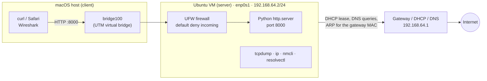
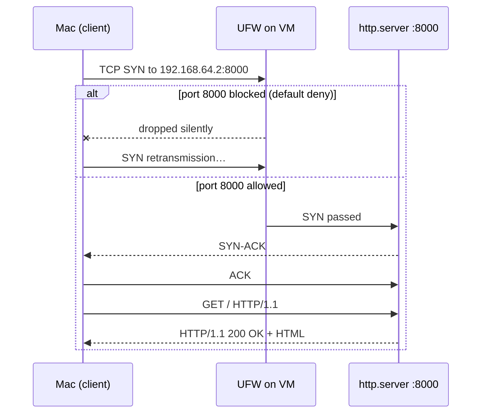

# Project 1 – Network & Firewall Lab

A small home lab I built to learn networking and host security by **testing things myself and watching the traffic**, rather than only reading about them. One Ubuntu virtual machine acts as a server, my Mac acts as the client, and every step is verified with packet captures and command-line tools.

**Status:** ongoing · **Labs so far:** 6 · **Started:** October 2026

## Lab environment

| Component | Details |
|-----------|---------|
| Client | macOS host, `curl`, Safari, Wireshark, `arp -a` |
| Server | Ubuntu VM in UTM, interface `enp0s1`, `192.168.64.2/24` |
| Gateway / DHCP / DNS | `192.168.64.1` (UTM virtual network) |
| Service under test | `python3 -m http.server 8000` |
| Host firewall | UFW |

## What I tested

| Lab | Question I wanted to answer | Key result |
|-----|-----------------------------|------------|
| [#1 – HTTP & TCP handshake](../../labs/2026-10-09-network-lab-1-http-wireshark.md) | What does a web request look like on the wire? | `SYN` → `SYN-ACK` → `ACK`, then `GET /` → `200 OK`, all in plaintext |
| [#2 – UFW firewall](../../labs/2026-10-11-network-lab-2-ufw-firewall.md) | What changes when a host firewall blocks a port? | Blocked: only `SYN` + retransmissions, no reply. Allowed: full handshake + `200 OK`. UFW logs show `SRC`, `DST`, `DPT`, `PROTO` |
| [#3 – Subnetting, DHCP & DNS](../../labs/2026-10-13-network-lab-3-subnetting-dhcp-dns.md) | Where does the VM's network configuration come from? | DHCP gave IP, mask, gateway, DNS and a 1-hour lease; `127.0.0.53` is only a local DNS stub |
| [#4 – ARP](../../labs/2026-10-16-network-lab-4-arp.md) | How does the VM find the gateway's MAC address? | Flush cache → ping → ARP Request (broadcast) → ARP Reply (unicast) captured in tcpdump |
| [#5 – DHCP & DNS capture](../../labs/2026-10-18-network-lab-5-dhcp-dns-capture.md) | Do DHCP and DNS look on the wire like they do in theory? | Only DHCP Request + ACK (the VM reused its previous lease); DNS query/response went `192.168.64.2 → 192.168.64.1` over UDP 53, not to the `127.0.0.53` stub |
| [#6 – Routing, traceroute & TTL](../../labs/2026-10-22-network-lab-6-routing-traceroute-ttl.md) | How does traceroute discover the path to a remote host? | Probes with TTL 1, 2, 3 … ; each router answers ICMP Type 11 (Time Exceeded), the destination answers Type 0 (Echo Reply). `tracepath` (UDP) hit `no reply`, `traceroute -I` (ICMP) reached Google |

## How a single request travels through the lab

## Skills practised

- **Networking:** IP vs MAC, ports, TCP handshake, CIDR and subnetting, default gateway, DHCP (DORA), DNS resolution, ARP, routing tables, hops and TTL
- **Linux:** `ip addr`, `ip route`, `ip neigh`, `resolvectl`, `nmcli`, `dig`, `ss`, `tracepath`, `traceroute`, `journalctl`, `sudo`
- **Host security:** UFW default-deny policy, allow rules, reading firewall logs, reverting changes safely
- **Traffic analysis:** Wireshark display filters (`tcp.port == 8000`, `dhcp`, `dns`, `icmp`), `tcpdump` capture filters (`arp`)
- **Documentation:** a write-up for every lab, including the mistakes I made and corrected

## Security lessons so far

1. **Plain HTTP is readable by anyone on the path** – the reason HTTPS matters.
2. **A firewall acts before the application**: a dropped port looks like silence, not an error.
3. **DHCP, DNS and ARP all rely on trust** on the local network, which is exactly why rogue DHCP servers, DNS spoofing and ARP spoofing (MITM) are possible.
4. **ICMP reveals the network map**: traceroute exposes internal hops and ISP routers, which is why many networks filter ICMP and why `no reply` is common.
5. **Verify, don't assume**: every conclusion in these labs is backed by a command output or a packet capture.

## Next steps

- Capture a **full** DHCP DORA (Discover and Offer too) from a fresh lease
- Compare UFW `deny` (drop) with `reject` on the wire
- Compare UDP, ICMP and TCP (`traceroute -T`) probes through a firewall
- Add a second VM to test traffic between two hosts on the same subnet
- Move on to web security basics (OWASP Top 10)
